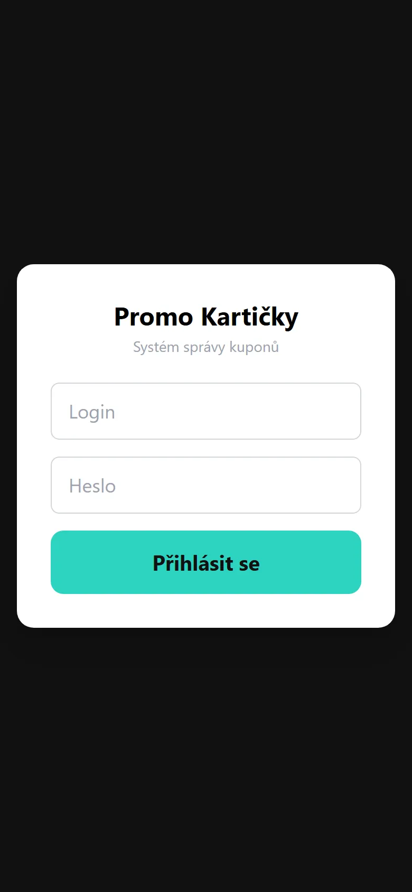
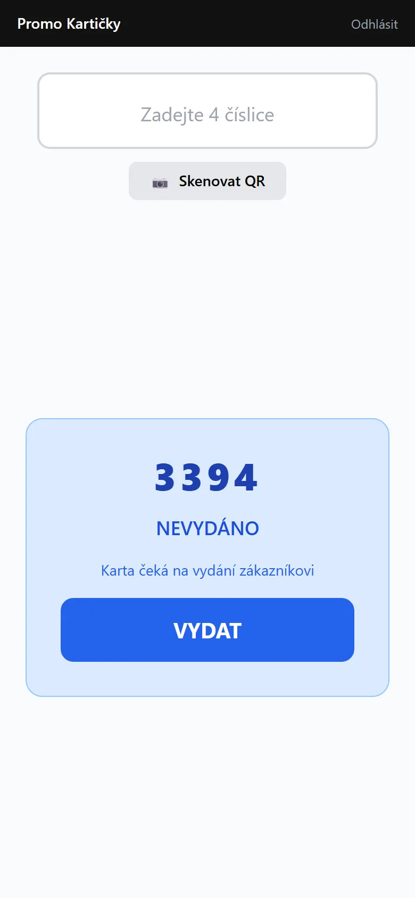
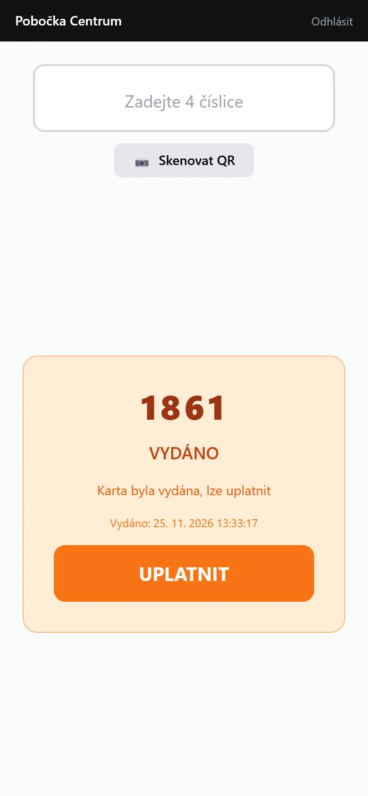
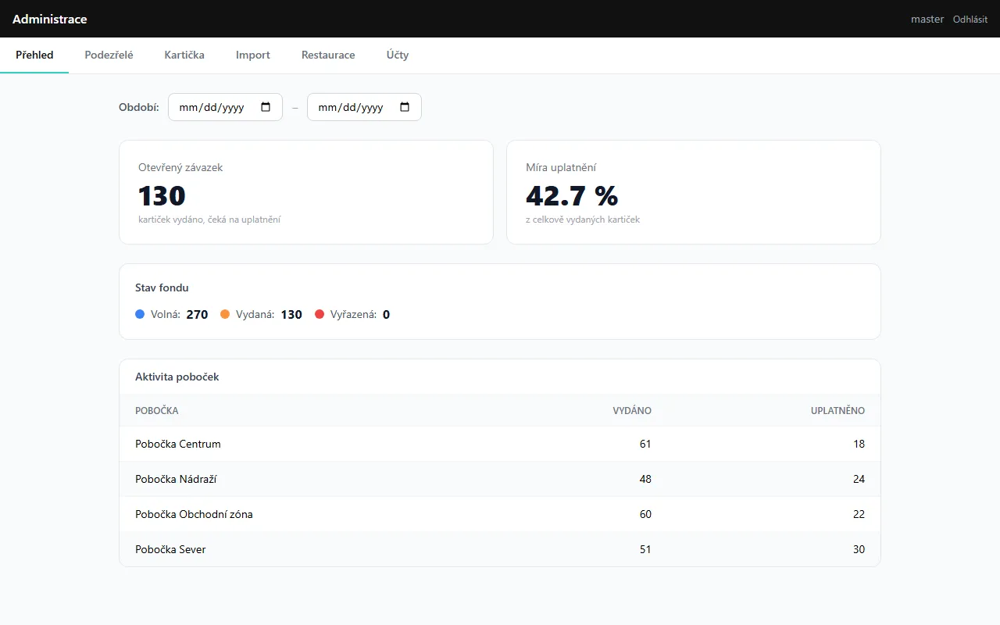
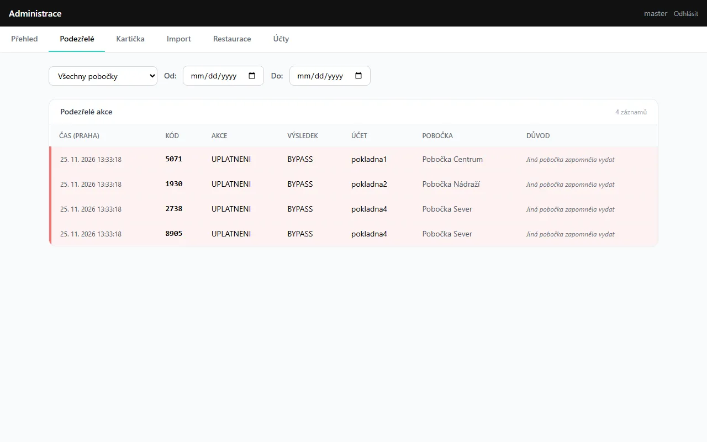

# Systém promo kuponů

PWA pro správu papírových promo kuponů v síti restaurací. Obsluha na pobočce naskenuje mobilem QR kód (nebo zadá 4místný kód) z laminované kartičky a kupon **vydá** nebo **uplatní**. Hodnotu nese stav kódu v databázi, ne papír, takže kopie kartičky je bezcenná. Manažeři vidí statistiky a podezřelé akce, master spravuje pobočky a účty.

> Projekt vznikl jako zakázka pro síť restaurací, do provozu nakonec nasazen nebyl. Screenshoty jsou z lokálního běhu s fiktivními pobočkami a kódy.

| Přihlášení | Nevydaná karta | Vydaná karta |
|---|---|---|
|  |  |  |

| Administrace: přehled | Administrace: podezřelé akce |
|---|---|
|  |  |

## Jak to funguje

- **Role:** operátor (pobočka, jen skenování) → manažer (přehledy, historie karty, import, vyřazení) → master (pobočky, účty).
- **Životní cyklus kuponu:** volný → vydaný → uplatněný (vrací se do oběhu) nebo vyřazený. Přechody jsou **atomické** (podmíněný UPDATE + zápis do auditního logu v jedné transakci), takže stejný kód nejde uplatnit dvakrát ani při souběhu.
- **Auditní log** je nezměnitelný. **Heuristiky podezřelosti** označí např. akce v nočním okně, změnu zařízení nebo uplatnění bez vydání („bypass“ s povinným důvodem).
- **Skenování QR** kamerou telefonu (html5-qrcode, se svítilnou), PWA jde nainstalovat na plochu.
- **Bezpečnost:** JWT v `httpOnly` cookie, bcrypt, rate limiting přihlášení, vynucená změna hesla po prvním přihlášení, tajemství jen z `.env`.
- **Fond kartiček:** `scripts/generate_cards.py` vygeneruje unikátní kódy do CSV (pro tisk, např. InDesign) a CSV se importuje v administraci.

## Stack

**Backend:** Python, FastAPI, SQLAlchemy 2, Alembic, PostgreSQL 16 · **Frontend:** Vue 3, Vite, Tailwind CSS, Pinia, vite-plugin-pwa · **Provoz:** Docker Compose, Caddy (automatické HTTPS), zálohy `scripts/backup.sh`

## Jak vzniklo s Claude Code

Postavené s Claude Code podle předem sepsaného zadání, ve fázích s revizí po každé fázi:

- [`SPECIFIKACE.md`](SPECIFIKACE.md) — závazné technické zadání (datový model, API, stavy, akceptační kritéria),
- [`CLAUDE.md`](CLAUDE.md) — pravidla pro Clauda: 10 fází buildu, konvence, povinné atomické přechody, žádná tajemství v kódu,
- [`report-promo-kupony.md`](report-promo-kupony.md) — nezávislá revize hotového kódu (nálezy podle závažnosti),
- [`docs/DOKUMENTACE.md`](docs/DOKUMENTACE.md) — uživatelská dokumentace pro obsluhu a manažery.

## Prerekvizity

- Docker ≥ 24 a Docker Compose v2
- VPS nebo server s veřejnou IP
- Doména s A-záznamem nasměrovaným na IP serveru (Caddy si automaticky vyřídí HTTPS)

## Rychlý start

```bash
git clone <url-repozitare>
cd promo-kupony
cp .env.example .env
# Otevřete .env a vyplňte: POSTGRES_PASSWORD, JWT_SECRET, MASTER_PASSWORD, DOMAIN
docker compose up -d --build
```

Po startu se backend automaticky provede databázové migrace a vytvoří master účet.
Přihlaste se na `https://<DOMAIN>` přihlašovacími údaji z `.env` (MASTER_LOGIN / MASTER_PASSWORD)
a při prvním přihlášení nastavte nové heslo.

## Podrobný návod

Viz [docs/DOKUMENTACE.md](docs/DOKUMENTACE.md) — nasazení, správa poboček, tisk karet, zálohy.

## Generování karet

```bash
python scripts/generate_cards.py --count 500 --output karty.csv
```

Vygenerovaný CSV importujte v sekci Administrace → Import.

## Licence

[MIT](LICENSE) © 2026 Pavel Procházka
